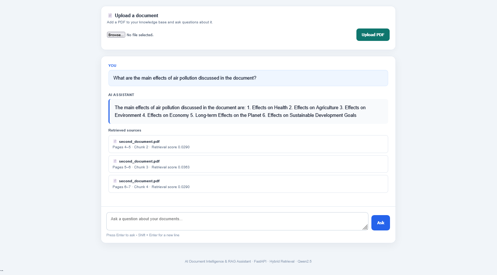
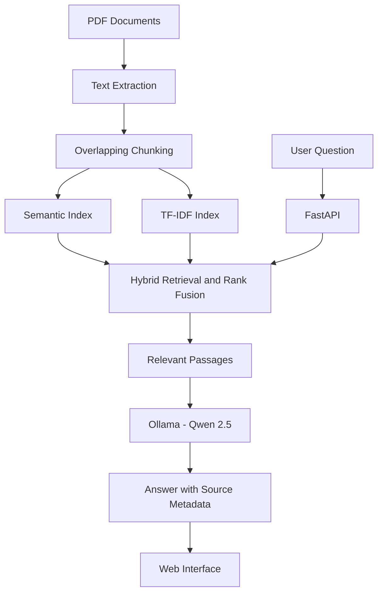

# AI Document Intelligence & RAG Assistant

A local Retrieval-Augmented Generation (RAG) application that lets users upload PDF documents and ask questions grounded in their contents.

## Features

- PDF text extraction with page-level metadata
- Overlapping text chunking
- Hybrid retrieval using semantic search and TF-IDF
- Reciprocal-rank fusion and custom retrieval scoring
- Local question answering with Qwen 2.5 through Ollama
- FastAPI endpoints for health checks, PDF uploads, and questions
- Source metadata to help trace answers to retrieved document passages
- Docker support

## Technology Stack

- Python
- FastAPI and Pydantic
- LangChain and Ollama
- Qwen 2.5 (3B) language model
- Nomic embeddings
- TF-IDF and semantic retrieval
- pypdf
- Docker

## How It Works

1. PDF documents are loaded and their text is extracted.
2. Text is split into overlapping chunks while preserving page information.
3. Chunks are indexed for semantic and lexical retrieval.
4. A user submits a question through the API.
5. Relevant passages are retrieved and provided to the language model.
6. The application returns an answer and source metadata.

## Application Screenshot



*The application answers questions using retrieved PDF passages and displays source citations, including page and chunk information.*


### Architecture



## Requirements

- Python 3.12 recommended
- Ollama
- The `qwen2.5:3b` and `nomic-embed-text` models
- Docker (optional)

## Local Setup

1. Install Python and Ollama.
2. Download the required Ollama models:

   ```bash
   ollama pull qwen2.5:3b
   ollama pull nomic-embed-text
   ```

3. Create and activate a virtual environment.
4. Install dependencies:

   ```bash
   pip install -r requirements.txt
   ```

5. Place PDFs you are authorized to process in the local `data/` directory.

6. Build the semantic index after adding PDFs:

   ```bash
   python -m app.semantic_index
   ```

   This creates `data/semantic_index.json`. Ensure Ollama is running and the required models are available before building the index.

7. Start the API from the project root:

   ```bash
   uvicorn app.api:app --host 127.0.0.1 --port 8000
   ```

8. Open `http://127.0.0.1:8000/docs` to view the API documentation.

The application expects its PDF documents and generated semantic index in `data/`. Do not commit private documents or generated indexes to source control.

## Running the Frontend

1. Start the FastAPI backend on port 8000:
   uvicorn app.api:app --host 127.0.0.1 --port 8000

2. Open a separate terminal from the project root and start the frontend server:
   python -m http.server 5500 --directory frontend

3. Open the frontend in your browser:
   http://127.0.0.1:5500/index.html
   
The frontend calls the backend at http://127.0.0.1:8000.

Keep both servers running while using the application.

## API Endpoints

| Method | Endpoint | Purpose |
|---|---|---|
| GET | `/` | API status message |
| GET | `/health` | Health check |
| POST | `/ask` | Ask a question about indexed documents |
| POST | `/upload` | Upload a PDF and rebuild the semantic index |

For `/ask`, send JSON such as:

```json
{
  "question": "What does the document say about this topic?"
}
```

For `/upload`, send a PDF as multipart form data using the field name `file`.

## Evaluation

Previously saved evaluation results recorded 10/10 functional checks passing on a small test set. This included source retrieval for answerable questions and refusal when documents did not contain enough information. This is a limited functional test, not a claim of 100% answer accuracy. Response time depends on local hardware and model inference.

## Project Structure

```text
app/
  api.py
  chunker.py
  config.py
  embeddings.py
  hybrid_retriever.py
  pdf_loader.py
  rag_pipeline.py
  semantic_index.py
  semantic_retriever.py
  tfidf_retriever.py
evaluation/
frontend/
Dockerfile
requirements.txt
README.md
```

## Privacy and Limitations

- Process only documents you have permission to use.
- Keep API keys, personal PDFs, and generated indexes out of GitHub.
- The language model runs locally through Ollama; response speed depends on available CPU and memory.
- Generated answers can be incomplete or incorrect. Verify important information against the source passages.

## Current Status

Core PDF ingestion, retrieval, question answering, API endpoints, and Docker configuration are implemented. Further testing, documentation, and clean-clone setup are ongoing.